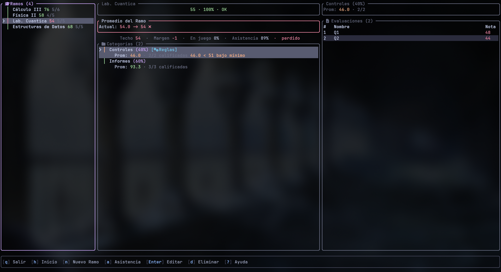

<div align="center">


<h1>KALK</h1>

**Tu dashboard académico en la terminal.**

[](README.md)
[](https://www.rust-lang.org/)
[](LICENSE)

</div>



---

Kalk responde una pregunta: **¿voy a aprobar, y qué necesito para lograrlo?**
Le describes cómo se evalúa cada ramo y Kalk te muestra tu situación real, en
la terminal y todo con el teclado.

- **Reglas de programas reales**: categorías con peso, descartar las peores,
  mínimos, topes de nota, asistencia y exámenes globales.
- **Lo que necesitas**: la nota que te falta en lo que queda, o un aviso claro
  cuando ya no se puede aprobar.
- **Números honestos**: lo que no tiene nota cuenta como cero, así que ves tu
  piso, junto al mejor caso al que todavía puedes llegar.
- **Semestres y dashboard**: promedios, créditos en riesgo y el ramo que
  necesita atención primero.
- **¿Y si…?**: prueba notas sin guardar nada.
- **Importación con IA**: pasa el programa del ramo a cualquier IA y revisa
  cada regla antes de aplicarla.
- **Tus datos, en tu máquina**: JSON plano, un respaldo de un solo archivo para
  cambiarte de computador, español e inglés.

Las notas van de 0 a 100 y se aprueba con 55 por defecto; 54.5 sube a 55 y
aprueba.

## Instalación

```bash
git clone https://github.com/yfloress/Kalk.git
cd Kalk
./install.sh --user
```

Necesitas [Rust](https://rustup.rs/) 1.85+. Una
[Nerd Font](https://www.nerdfonts.com/) es opcional, para los iconos. Otros
sistemas y opciones están en la [guía de instalación](docs/INSTALL_ES.md).

## Uso

Ejecuta `kalk` y presiona `?` para ver todos los atajos. Los primeros que vale
la pena saber:

| Tecla | Hace |
|-------|------|
| `n` / `Enter` / `d` | Nuevo, editar, eliminar |
| `s` | Simular notas; otra `s` deja todo como estaba |
| `h` | Semestres y dashboard |
| `e` / `i` en Home | Exportar / importar todo |

## Contribuir

[`AGENTS.md`](AGENTS.md) explica la arquitectura y las convenciones;
`nix develop` deja el entorno listo.

## Licencia

[AGPL-3.0 o posterior](LICENSE).
